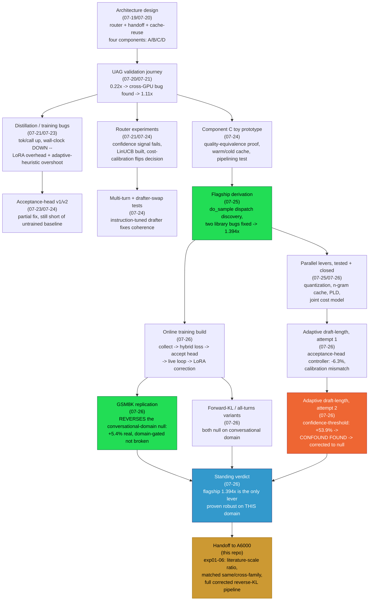

# Script Index — what ran when, and what it proved

Every script in `t4-session/scripts/` was a real, working experiment at the time it ran — this index is the map from script name to date, purpose, result, and where the full writeup lives in `PROJECT_README.md` / `RESEARCH_LOG.md`. Read this file when you need "which script produced that number," not the full narrative.

**How to navigate**: the flowchart below shows the shape of the whole project. The tables after it are the detail — one row per script, grouped into the same phases as the flowchart.

---

## The shape of the project

Green = the two results that hold up as real, positive findings (flagship 1.394x, GSM8K online-training reversal). Red = the result that looked biggest and turned out to be a pure bug (the +53.9% adaptive-window confound). Blue = the standing verdict as of the end of the T4 session. Orange = where this repo's own `experiments/` picks up.

---

## Phase 1 — Architecture design and early UAG validation (2026-07-19 to 07-21)

No scripts yet — this phase is pure design, fully written up in `RESEARCH_LOG.md` lines 1-1430 (the four-component framework, the paper map, Component C's three redesigns). Start there if you need the "why" behind any later script's existence.

| Script | Date | Purpose | Key result |
|---|---|---|---|
| `prep_locomo_data.py` | 07-20 | Extract prompt/held-out sets from the LoCoMo conversational dataset | Produced the 30-prompt sets reused by almost every later script |
| `uag_experiment.py` → `uag_experiment4.py` | 07-20/07-21 | First cross-vocab SD tests, chasing a mysterious 0.22x-0.33x speedup | Ruled out vocab size and translation cost as causes; found 94% of per-call time unaccounted |
| `uag_timing_experiment.py` | 07-21 | Fine-grained per-call timing instrumentation | Isolated the unaccounted time to "target verification + loop overhead" |
| `uag_cache_experiment.py` | 07-21 | Custom translation-cache hit-rate test | 100% cache hit rate, speedup unchanged — ruled out translation as the bottleneck |
| `uag_singlegpu_experiment.py`, `uag_fp16_singlegpu.py` | 07-21 | Test the cross-GPU-splitting hypothesis directly | **Root cause confirmed**: single-GPU fp16 gave 0.95x-1.29x, avg ~1.11x, all outputs exact-matched baseline |

## Phase 2 — Router experiments (2026-07-21 to 07-24)

| Script | Date | Purpose | Key result |
|---|---|---|---|
| `linucb_router.py` | 07-22 | LinUCB contextual bandit router (OrcaRouter pattern, 2-arm) | Mechanically correct; with placeholder costs picked `escalate_sd` 28/30 rounds — flagged as a calibration artifact |
| `uag_speedup_one.py` | 07-21 | Single calibration-prompt speedup/confidence check | Part of the 15-prompt calibration set that found confidence does NOT predict speedup (inversely correlated) |
| `uag_phase2_speedup.py` | 07-21 | Router-gated speedup test (median-split threshold) | Skip rate exactly 50% — confirmed self-referential threshold artifact, predicted in advance |
| `ratio_test_for_a6000.py` | 07-22 | Prep script isolating ratio as a variable, staged for bigger-scale A6000 testing | Precursor to this repo's `exp01`/`exp02` |

Full router calibration story (real-cost flip from `escalate_sd`-preferred to `small_alone`-preferred, and the 12/12-escalated threshold-miscalibration finding) is in `RESEARCH_LOG.md` around the 2026-07-21/07-24 LinUCB entries — no separate script, computed from logged data.

## Phase 3 — Distillation / training bugs, and acceptance-head v1/v2 (2026-07-21 to 07-24)

| Script | Date | Purpose | Key result |
|---|---|---|---|
| `uag_distill.py` | 07-21 | First reverse-KL distillation training run | Train-set tok/call +5% — later found to be memorization |
| `uag_distill_heldout.py` | 07-21 | Held-out re-evaluation of the same training | tok/call **-0.9%** on 6 new prompts — the memorization catch |
| `uag_distill_scaled.py` | 07-22 | 30-prompt re-eval at scale | tok/call **+10.6%** (2.159 → 2.388), looked like a real win |
| `uag_diagnose_wallclock.py` | 07-22 | Full wall-clock comparison of the above | **Reversed the verdict**: avg speedup 1.295x → 1.042x, 28/30 prompts worse in real time despite the tok/call gain |
| `uag_lora_06b.py` | 07-22 | LoRA training on Qwen3-0.6B, isolating adapter overhead | Unmerged adapter = 1.443x slower than merged (44% pure overhead) |
| `uag_full_pipeline.py` | 07-23 | Fixed-draft-length test (bypassing the adaptive heuristic) | Trained avg speedup recovered to 1.210x (from 1.042x) |
| `uag_ratio_fix_full.py` | 07-23 | Ratio-fix (Llama-68M, ~132:1) + avg_K diagnosis | Root cause of the tok/call-vs-wallclock gap: reverse-KL makes the drafter more confident, inflating proposed draft length (avg_K 1.83 → 3.38) without proportional acceptance-rate gain |
| `uag_acceptance_head_llama68m_full.py` | 07-23/07-24 | Acceptance-head v2 (correct ratio, hidden states captured free during drafting) | Head accuracy 0.6506; partial fix of avg_K (3.38 → 3.066), roughly on par with fixed-length-4 |

## Phase 4 — Component C toy prototype, multi-turn tests (2026-07-24)

No standalone scripts survived from this phase in the scratchpad — results are in `t4-session/results/component_c_toy_results.json`, `component_c_wallclock_grid_results.json`, `multiturn_results.json`, `qa_multiturn_results.json`, `qa_multiturn_v2_results.json`, `pipeline_results.json`, `pipeline_realistic_results.json`, `prefill_scaling_results.json`, `warm_cold_results.json`, `warm_cold_realistic_results.json`, `real_router_results.json`. Full writeup: `PROJECT_README.md` §6.6-6.7.

Key numbers: quality-equivalence F1 0.186 (SD-handoff) vs 0.182 (plain) vs 0.051 (small-alone); warm/cold cache reuse at realistic scale **1.307x**; same-GPU pipelining **0.995x** (a wash, reopened later under real network latency).

## Phase 5 — Flagship derivation (2026-07-25)

| Script | Date | Purpose | Key result |
|---|---|---|---|
| `mixed_complexity_test.py` | 07-25 | Baseline mixed-complexity conversational test | Original baseline before the dispatch discovery |
| `diag_translator.py` | 07-25 | Standalone diagnostic isolating the two `AssistantToTargetTranslator` bugs | Confirmed both bugs (missing `assistant_overlap_token_ids`, logits shape mismatch) in isolation before patching |
| `mixed_complexity_test_sampled.py` | 07-25 | Sampling-mode verification with the fixed, better translator | tok/call 2.883 but speedup only 1.132x — sampling verification overhead eats the gain |
| `mixed_complexity_test_greedy_directmap.py` | 07-25 | **Greedy verification + fixed direct-mapping translator, forced via monkey-patch** | **The flagship: 1.394x avg speedup, tok/call 2.797** |
| `quantized_drafter_speedup.py`, `test_fused_kernels.py`, `test_load_memory.py` | 07-25 | GPTQ Int4 quantization test, kernel-availability check, memory-fit check | EXLLAMA_V2 the only working fused kernel on T4; 1.111x vs fp16's 1.185x — ruled out |

## Phase 6 — Parallel levers: n-gram cache, PLD, joint cost model (2026-07-25/07-26)

| Script | Date | Purpose | Key result |
|---|---|---|---|
| `ngram_feasibility.py` | 07-25 | First (mis-scoped) attempt — phrase-repetition coverage analysis | Wrongly concluded "don't build it" — later corrected, this wasn't OmniDraft's actual mechanism |
| `ngram_merge_sd.py` | 07-25 | The REAL OmniDraft n-gram cache — cross-vocab token-translation merge | Cache grew to 23 entries, 98.3% direct-map rate, 86.6% cache-hit rate on the rest |
| `ngram_merge_sd_kvcache.py` | 07-26 | Same mechanism with proper KV-cache reuse in the test loop | Isolated that the earlier wall-clock wash was the test loop's own lack of cache reuse, not the mechanism |
| `pld_test.py` | 07-26 | Prompt Lookup Decoding (no draft model, string-match n-grams) | 0.998x, breakeven — independent confirmation that this domain lacks exploitable repetition |
| `strengthen_core_speedup.py` | 07-26 | Precursor cost-accounting script | Feeds into `joint_cost_model.py` |
| `joint_cost_model.py` | 07-26 | Pure-arithmetic model combining measured/published/simulated network+drafter+server numbers | Server compute **2.797x unconditional**; user-latency 1.0x-1.7x depending on conditions, collapsing to breakeven only in the worst-case stack |

## Phase 7 — Online training build (2026-07-26)

| Script | Date | Purpose | Key result |
|---|---|---|---|
| `online_train_collect.py` | 07-26 | Step 1: data collection (drafter/target pairing, tagging direct-mapped vs n-gram-merged tokens) | 484 records after fixing a truncation bias that had discarded all negative examples |
| `diag_gemma_predictions.py`, `diag_suppression_rate.py` | 07-26 | Diagnostics for a near-total collection failure (2 records across 8 questions) | Found the real bug: drafter prompt corrupted by the target's own special tokens (not a cache/attention bug, ruled out first) |
| `hybrid_loss.py` | 07-26 | Step 2: reverse-KL (direct-mapped) + NLL (n-gram-merged) hybrid loss, with NaN fix | Manual `torch.where` KL computation fixes `0 * -inf = NaN` |
| `acceptance_head.py` | 07-26 | Step 3: acceptance-prediction head, continuous-ratio BCE label | Labels span full 0.0-1.0 range after the truncation-bias fix |
| `online_train_live.py` | 07-26 | Step 4: full live training loop, reverse-KL, LoRA (corrected from an initial full-fine-tuning version) | Conversational domain: losses decrease (~10%/~40%/~9%), tok/call flat/slightly worse (-3.9%) |
| `gsm8k_replication.py` | 07-26 | Replication under OmniDraft's own conditions (Llama-68M, GSM8K), train-vs-control | **Reverses the verdict: +5.4% real, isolated with a proper control** — mechanism works, domain-gated not broken |
| `online_train_live_fwdkl.py` | 07-26 | Forward-KL variant (DistillSpec's greedy-decoding recommendation) on the conversational domain | **-12.2%**, worse than reverse-KL — rules out loss-direction as the gating variable |
| `online_train_live_allturns.py` | 07-26 | Train on SD-verified AND naive-handoff turns, alternated by question | **-7.9%**, and for the first time the SD-branch losses themselves stopped improving — diagnosed as objective interference from alternating training objectives on shared LoRA weights |

## Phase 8 — Adaptive draft-length controllers (2026-07-26)

| Script | Date | Purpose | Key result |
|---|---|---|---|
| `adaptive_draft_length.py` | 07-26 | Attempt 1: acceptance-head as a live stopping controller (frozen drafter, head-only training) | **-6.3%** — controller stopped after ~1.7 tokens avg; diagnosed as a threshold/label mismatch (continuous ratio vs binary accept event) |
| `confidence_adaptive_draft_length.py` | 07-26 | Attempt 2: training-free confidence-threshold controller (drafter's own top-softmax probability, no training) | First sweep: **+53.9%** at best threshold — then a confound found (missing repetition-penalty/EOS-handling vs the fixed baseline); after fixing, **every threshold within ~3% of baseline, genuinely null, retracted** |
| `fixed8_control.py` | 07-26 | Control: plain fixed window=8, no adaptivity | 1.3879 vs fixed-5's 1.3880 — confirmed "bigger cap alone" wasn't the explanation for the (later-retracted) +53.9% |
| `gen_heldout_pairs.py` | 07-25 | Utility: generate held-out question/answer pairs for quality-equivalence checks | Supporting utility, used across several phases |

---

## Standing verdict at handoff (2026-07-26)

> *"The flagship direct-mapping + greedy-verification result (1.394x) remains the only lever that has robustly helped on this specific conversational deployment domain — every additional mechanism tried this session (quantization, n-gram cache, PLD, online training in three configurations, both adaptive-window approaches) has been null or negative here, though several (online training, n-gram cache) are confirmed real on other domains (GSM8K, repetitive/structured content)."*

This is exactly what `exp01`-`exp06` in this repo's `experiments/` directory pick up from — see the top-level `README.md` and `CONCLUSIONS.md` for what's still open at real (A6000) scale.

## What's deliberately NOT in this repo

- **Large trained-model checkpoints** (`trained_drafter_reverse_kl_gemma2_9b/`, `trained_drafter_v1/`, `trained_drafter_with_acceptance_head/`, `trained_llama68m_with_acceptance_head/` — roughly 205MB total) were left out of git to avoid bloating the repo without LFS. They still exist locally at `/Users/anirudh/Anirudh/research/hybrid/vm-artifacts/` on the machine this was written on, if ever needed — but given the online-training verdict is domain-gated (real on GSM8K, null on conversational Q&A) and every one of these was trained on the T4 before the LoRA-vs-full-fine-tuning correction, retraining fresh on the A6000 with the corrected methodology is very likely the better move rather than reusing these.
- **Verbose log files** (`vm-artifacts/logs/*.log`) — kept locally, not copied in; they're raw stdout captures with no information beyond what's already distilled into `RESEARCH_LOG.md`.
- **Raw JSON results from this session's later (2026-07-26) online-training/adaptive-window runs** — these lived only on a rented GPU VM whose Cloudflare tunnel has since gone down (expected, ephemeral). The exact numbers are preserved in `PROJECT_README.md` and `RESEARCH_LOG.md`; only the raw artifact files themselves are unrecoverable.
